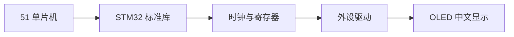

# 学习指北

记录 · 可视化 · 回顾 —— 一个自己搭的学习站。

## 我在学什么

| 方向 | 进度 | 最近的笔记 | 状态 |
|---|---|---|---|
| STM32 / 嵌入式 | ██████░░░░ 60% | [STM32 GPIO 输出模式](notes/2026-10-14-stm32-gpio.md) | 进行中 |
| 51 单片机 | ███░░░░░░░ 30% | — | 暂停 |
| C / C++ | ████░░░░░░ 40% | — | 进行中 |

## 学习路线

## 快速入口

- [学习笔记总览](notes/index.md)
- [学习成果展示](projects/index.md)
- [复习与复盘](review/index.md)

!!! tip "这个站怎么用"
    右上角搜索框支持中文全文搜索。忘了某个知识点叫什么名字，直接搜关键词就行。
